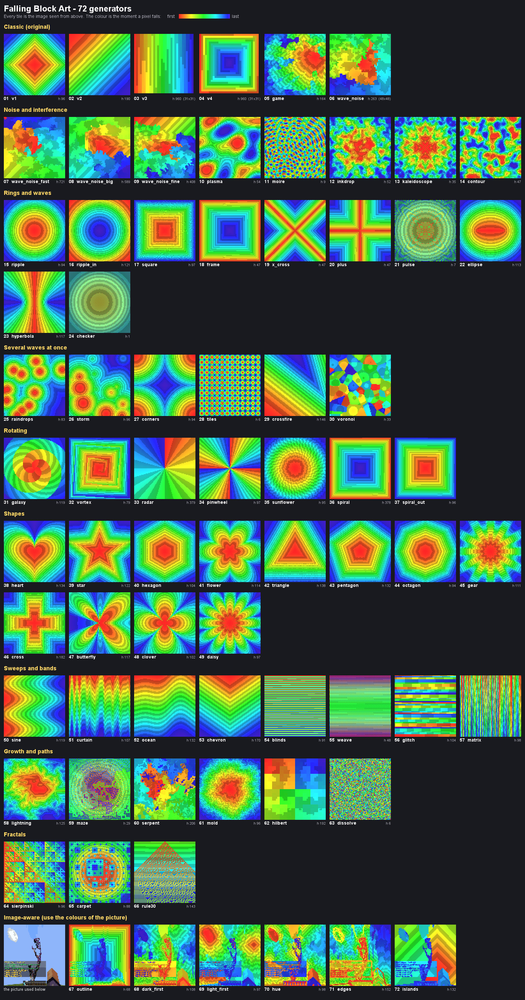

# Falling Block Art - Minecraft Generator

🎨 **Falling Block Generator for Minecraft** - a mod for creating artistic images from falling sand blocks in Minecraft using various height generation algorithms.


*Example of mod operation - creating an image from falling blocks*

## 📋 Description

This mod allows you to create beautiful artistic compositions from falling blocks in Minecraft. The mod analyzes images and creates three-dimensional structures using various height generation algorithms, turning ordinary images into structures made of sand blocks. When the first block is destroyed, the entire structure begins to fall, creating an amazing animation that gradually reveals the hidden image. Each block falls in the correct sequence, forming the original picture during the falling process.

## ✨ Features

- **Multiple height generation algorithms**: several different algorithms for creating unique structures
- **Asynchronous generation**: Does not block the server during creation of large images
- **Gradual block placement**: Blocks are placed gradually for better performance
- **Support for various formats**: PNG and JPG images
- **Color palette**: 16 concrete powder colors for accurate image reproduction
- **Interactive commands**: Simple command system with autocompletion

## 🚀 Installation

### Requirements
- Minecraft 26.3 (Java 25)
- Fabric Loader 0.19.5+
- Fabric API 0.165.0+26.3+

### Installation steps
1. Install Fabric Loader for Minecraft 26.3
2. Download and install Fabric API
3. Download the newest `experiments-26.3-vN.jar` from the [Releases](../../releases) page and place it in the `mods` folder
4. Launch Minecraft

## 📖 Usage

### Generation command
```
/image <width> <height> <algorithm> <file>
```

### Parameters
- **width** - image width in blocks
- **height** - image height in blocks
- **algorithm** - one of the available algorithms (see below)
- **file** - image filename from the `.minecraft` folder

### Algorithms and effects
The algorithm decides in which order and shape the blocks fall during `/image collapse`.
There are **72 algorithms** (waves, shapes, spirals, fractals, mazes, image-aware ones and more) and **9 effects**
that can be added behind the file name and combined with `+`:

```
/image <width> <height> <algorithm> <file> [effects]
/image collapse [effects]
```



The full list with a description of every name and effect is in [docs/GENERATORS.md](docs/GENERATORS.md).

Effects: `jitter`, `assemble`, `burst`, `swirl`, `scatter`, `tilt`, `slow`, `avalanche`, `pulse`.

A build may reach at most Y 999 (and never above the world's build limit); if an image is too tall for the chosen
algorithm the command tells you so. `v3` and `v4` are very tall, use them for small images only.

### Command examples
```
/image 64 64 heart my_image.png
/image collapse
/image 96 96 radar my_image.png jitter
/image collapse burst
/image 64 64 outline my_image.png assemble+slow
/image 32 32 v1 my_image.png
/image 16 16 wave_noise landscape.jpg
/image 50 50 game portrait.png
```

### After the blocks have fallen
The torches that hold the blocks up drop as items when everything falls. Remove them afterwards, otherwise the
world starts to lag:
```
/kill @e[type=item,nbt={Item:{id:"minecraft:torch"}}]
```

### Image preparation
1. Place images in the `.minecraft` folder (Minecraft root folder)
2. Supported formats: PNG, JPG
3. It is recommended to use images with clear contrasts

## 📝 License

MIT License - see [LICENSE](LICENSE) file for details.

## 🤝 Contributing

Contributions are welcome! Please:
1. Fork the repository
2. Create a branch for the new feature
3. Make changes
4. Create a Pull Request
