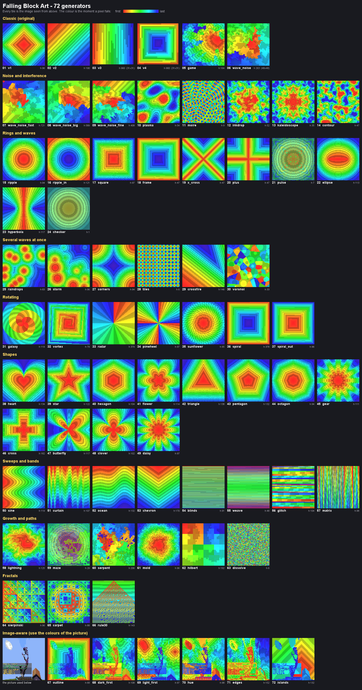

# Generators

**72 generators** and **9 effects**. Every effect works with every generator and they can be combined (80 combinations including none), so there are 72 x 80 = 5,760 different ways to let an image fall.



Every tile above is the image seen from above. The colour is the moment a pixel falls (red = first, blue = last); `h` is the height of the build at 96x96.

```
/image <width> <height> <generator> <file> [effects]
/image collapse [effects]
```

## Count per group

| Group | Generators |
|---|---|
| Classic (original) | 6 |
| Noise and interference | 8 |
| Rings and waves | 10 |
| Several waves at once | 6 |
| Rotating | 7 |
| Shapes | 12 |
| Sweeps and bands | 8 |
| Growth and paths | 6 |
| Fractals | 3 |
| Image-aware (use the colours of the picture) | 6 |
| **Total** | **72** |

## All names

### Classic (original) (6)

| # | Name | Falling pattern |
|---|---|---|
| 1 | `v1` | diamond from the centre |
| 2 | `v2` | diagonal sweep from a corner |
| 3 | `v3` | snake, row by row (very tall: small images only) |
| 4 | `v4` | square spiral path (very tall: small images only) |
| 5 | `game` | random brush strokes |
| 6 | `wave_noise` | the original noise waves, kept as a reference (slow on big images, use wave_noise_fast) |

### Noise and interference (8)

| # | Name | Falling pattern |
|---|---|---|
| 7 | `wave_noise_fast` | same kind as wave_noise (a flood that follows Perlin noise, about 10 blocks per height), but 300x faster: safe for big images |
| 8 | `wave_noise_big` | wave_noise_fast with bigger blobs (tall build) |
| 9 | `wave_noise_fine` | wave_noise_fast with finer blobs |
| 10 | `plasma` | classic demo-scene plasma: the flowing contour lines of a few sine waves |
| 11 | `moire` | three sets of rings on top of each other: the pixels fall along the interference pattern |
| 12 | `inkdrop` | a drop of ink in water: a ripple whose front is pushed around by noise |
| 13 | `kaleidoscope` | noise folded eight times around the centre: a symmetrical, kaleidoscope-like ripple |
| 14 | `contour` | contour lines of smooth noise, like water running off a landscape |

### Rings and waves (10)

| # | Name | Falling pattern |
|---|---|---|
| 15 | `ripple` | round wave from the centre |
| 16 | `ripple_in` | round wave closing in from the edges |
| 17 | `square` | square rings from the centre |
| 18 | `frame` | square rings closing in from the edges |
| 19 | `x_cross` | both diagonals fall first, then it spreads out |
| 20 | `plus` | the centre lines fall first, then it spreads out |
| 21 | `pulse` | ripple in two beats: all even rings, then all odd rings |
| 22 | `ellipse` | ellipses around two foci |
| 23 | `hyperbola` | hyperbolas around two foci |
| 24 | `checker` | chessboard: the dark squares as a ripple, then the light squares |

### Several waves at once (6)

| # | Name | Falling pattern |
|---|---|---|
| 25 | `raindrops` | random drops that start together; their waves run into each other |
| 26 | `storm` | random drops that start one after another |
| 27 | `corners` | waves from the four corners meeting in the middle |
| 28 | `tiles` | a small ripple in every 8x8 tile |
| 29 | `crossfire` | three straight wave fronts from random directions |
| 30 | `voronoi` | the image breaks into random shards that fall one after another |

### Rotating (7)

| # | Name | Falling pattern |
|---|---|---|
| 31 | `galaxy` | round wave with curved spiral arms |
| 32 | `vortex` | square rings that twist more and more |
| 33 | `radar` | a line sweeping clockwise around the centre, like a clock hand |
| 34 | `pinwheel` | four blades sweeping at the same time |
| 35 | `sunflower` | golden-angle seeds: spiral arms winding outwards |
| 36 | `spiral` | square spiral from the edge to the centre (low version of v4) |
| 37 | `spiral_out` | square spiral from the centre to the edge |

### Shapes (12)

| # | Name | Falling pattern |
|---|---|---|
| 38 | `heart` | a heart that keeps growing |
| 39 | `star` | a five-pointed star that keeps growing |
| 40 | `hexagon` | a hexagon that keeps growing |
| 41 | `flower` | a six-petal flower that keeps growing |
| 42 | `triangle` | a triangle that keeps growing |
| 43 | `pentagon` | a pentagon that keeps growing |
| 44 | `octagon` | an octagon that keeps growing |
| 45 | `gear` | a cog wheel with 12 teeth that keeps growing |
| 46 | `cross` | a plus sign that keeps growing |
| 47 | `butterfly` | the butterfly curve (wings and antennae) that keeps growing |
| 48 | `clover` | a four-leaf clover that keeps growing |
| 49 | `daisy` | a daisy with 12 petals that keeps growing |

### Sweeps and bands (8)

| # | Name | Falling pattern |
|---|---|---|
| 50 | `sine` | wavy sweep from left to right |
| 51 | `curtain` | top to bottom with drips that run ahead |
| 52 | `ocean` | top to bottom with two layers of waves on the front |
| 53 | `chevron` | a V shaped front pulled down from the top centre, like a zipper |
| 54 | `blinds` | venetian blinds: every third row first, then the rows in between |
| 55 | `weave` | even columns fall downwards while odd columns fall upwards |
| 56 | `glitch` | bands of random thickness fall at random moments, like a glitching screen |
| 57 | `matrix` | digital rain: every column starts at its own moment and falls at its own speed |

### Growth and paths (6)

| # | Name | Falling pattern |
|---|---|---|
| 58 | `lightning` | cracks shooting out from the centre along random channels |
| 59 | `maze` | the walls fall first, then a random maze is eaten away along its corridors |
| 60 | `serpent` | one long winding snake that fills the whole image |
| 61 | `mold` | organic growth from the centre, like mould or moss |
| 62 | `hilbert` | one line winding through the image along a Hilbert curve |
| 63 | `dissolve` | every pixel falls at a random moment |

### Fractals (3)

| # | Name | Falling pattern |
|---|---|---|
| 64 | `sierpinski` | the Sierpinski triangle first, then the fractal level by level |
| 65 | `carpet` | the Sierpinski carpet first, then the fractal level by level |
| 66 | `rule30` | cellular automaton 'rule 30' growing down from the top centre |

### Image-aware (use the colours of the picture) (6)

| # | Name | Falling pattern |
|---|---|---|
| 67 | `outline` | background first; the wave stalls at colour borders, the objects fall last |
| 68 | `dark_first` | dark blocks first, light blocks last |
| 69 | `light_first` | light blocks first, dark blocks last |
| 70 | `hue` | greys first, then the colours in rainbow order |
| 71 | `edges` | the edges of the objects first, the flat areas after them |
| 72 | `islands` | every area of one colour is an island; the biggest island first |

## Effects (9)

Add them behind the file name and combine them with `+`, for example `/image 64 64 heart picture.png burst+jitter`. `/image collapse swirl` collapses the last build with another motion than the one it was built with.

| Name | Applies to | What it does |
|---|---|---|
| `jitter` | build + collapse | random offset on the fall times: a tidy pattern becomes a bit ragged |
| `assemble` | build | the image is built in the order of the pattern instead of from the bottom up |
| `burst` | collapse | blocks are thrown outwards from the centre and fall in an arc |
| `swirl` | collapse | blocks are pushed around the centre and fall in a spiral |
| `scatter` | collapse | a random push in every direction (dust) |
| `tilt` | collapse | all blocks lean the same way, like dominoes |
| `slow` | build + collapse | 4 blocks per tick instead of 15 |
| `avalanche` | build + collapse | starts slowly and speeds up to 25 blocks per tick |
| `pulse` | build + collapse | swings between 3 and 25 blocks per tick |

Only one motion (`burst`, `swirl`, `scatter`, `tilt`) and one rhythm (`slow`, `avalanche`, `pulse`) can be used at once; if you give several, the last one counts. With a motion effect, blocks that land badly vanish instead of dropping as items.

## Height

A build may reach at most Y 999 (blocks above about Y 1000 drop as items) and never above the world's build limit. If a generator would need more height, the command tells you before it places anything. `v3` and `v4` are very tall (about width x height blocks), use them for small images only; `radar`, `spiral`, `serpent`, `cross` and `wave_noise_big` are the tallest of the others. `wave_noise` is the original and takes several seconds on a 96x96 image (the mod gives up after 30 s); `wave_noise_fast` makes the same kind of pattern in a few milliseconds.
